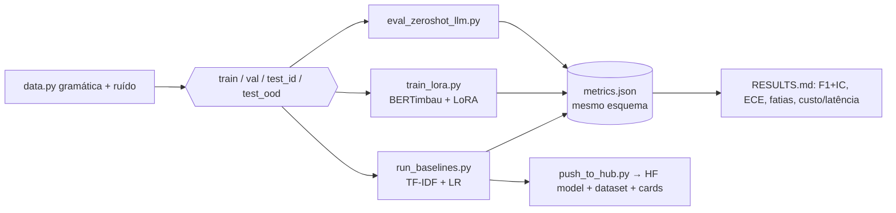

# food-review-llm

Pipeline de classificação de **aspecto** e **sentimento** de reviews de delivery em PT-BR: geração de dataset com split de distribuição, baselines clássicos avaliados com IC bootstrap, calibração e fatias de erro, script de **fine-tuning LoRA**, baseline **zero-shot com LLM** e publicação no Hugging Face.

> **Estado honesto.** Rodado e medido aqui: dados, baselines, métricas, testes. **Escrito mas NÃO executado** (sem GPU, sem torch, sem chave de API, sem token do Hub neste ambiente): `scripts/train_lora.py` (só `--dry-run` validado), `scripts/eval_zeroshot_llm.py`, `scripts/push_to_hub.py`. Portanto **não há ainda nenhum número de LoRA nem de LLM** neste repositório, e nada foi publicado no Hugging Face. O dataset é **sintético**.

## O que o experimento mostra (macro-F1, `docs/RESULTS.md`)
| tarefa | modelo | test_id | test_ood [IC95%] | ECE ood |
|---|---|---|---|---|
| aspecto | majority | 0.096 | 0.100 | 0.75 |
| aspecto | TF-IDF palavra+char + LR | **1.000** | **0.662** [0.63, 0.69] | 0.06 |
| sentimento | majority | 0.165 | 0.167 | 0.67 |
| sentimento | TF-IDF palavra+char + LR | **1.000** | **0.413** [0.38, 0.45] | 0.29 |

1. **O teste in-distribution não discrimina nada:** 1.000 com a gramática compartilhada. Reportar só isso seria enganoso.
2. **Sob mudança de distribuição o bag-of-words colapsa** (sentimento: 0.41; um chute aleatório em 3 classes balanceadas daria ≈0.33). Por fatia (sentimento, OOD): negação **0.25** (n=181), typo 0.40, limpo 0.45. Erros inspecionados (`artifacts/errors_ood.csv`): substantivos nunca vistos ("motoboy", "saquinho", "lanche") com predicados genéricos ("foi show"), e negação ("não demorou nada" lido como negativo).
3. **Hipótese a testar com LoRA (não verificada):** um encoder pré-treinado (BERTimbau) deve ganhar principalmente em negação e vocabulário novo. O experimento está pronto para confirmar ou refutar isso — se não ganhar, esse também é o resultado.

## Arquitetura do pipeline


## Rodando
```bash
make install && make data && make baselines && make test      # 8 testes; tudo em CPU, ~10 s
# Com GPU (Colab):
pip install -e ".[lora]" && python scripts/train_lora.py --task sentiment      # gera artifacts/lora_sentiment/metrics.json
# Com chave de API (informe os preços vigentes; não há padrão):
ANTHROPIC_API_KEY=... python scripts/eval_zeroshot_llm.py --model <id> --price-in <usd/1M> --price-out <usd/1M>
# Publicar (privado por padrão):
pip install -e ".[hub]" && HF_TOKEN=... python scripts/push_to_hub.py --user <usuario>
```

## Decisões
- **Split por texto + split OOD** em vez de um único aleatório: o aleatório daria 1.000 e esconderia o problema.
- **Mesmo esquema de métricas** para baseline, LoRA e LLM → tabela comparável incluindo custo por 1k e latência.
- **Dados sintéticos** porque não há dataset público de reviews de delivery PT-BR licenciado nesta entrega; o pipeline aceita CSV real (`text,aspect,sentiment`).
- **ECE** reportado: um modelo confiante e errado sob OOD é pior que um errado e incerto.

## Limitações / próximos passos
Rodar LoRA e zero-shot e preencher a comparação (F1, ECE, p95, custo/1k); trocar o dataset por reviews reais com rótulo humano e medir concordância; multi-aspecto por review; quantização (int8) e medição de latência de servidor.
Cards: [DATA_CARD](docs/DATA_CARD.md) · [MODEL_CARD](docs/MODEL_CARD.md).
